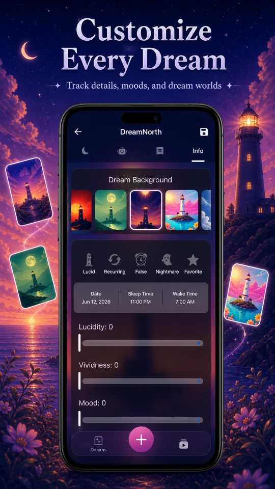
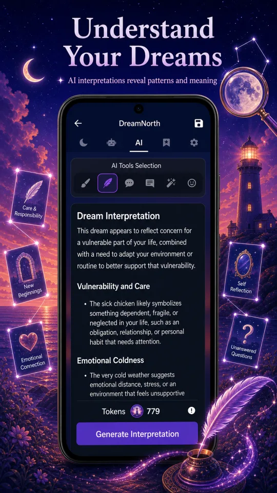
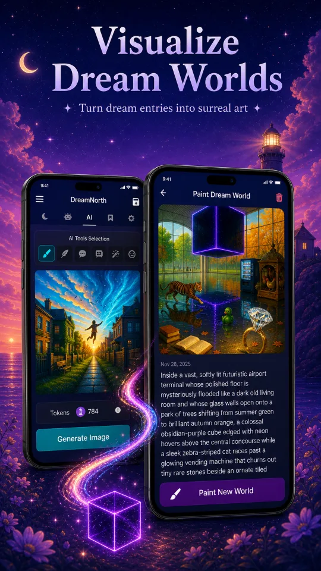
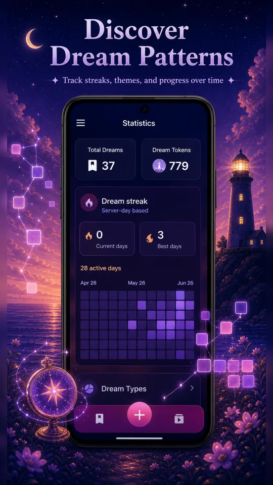
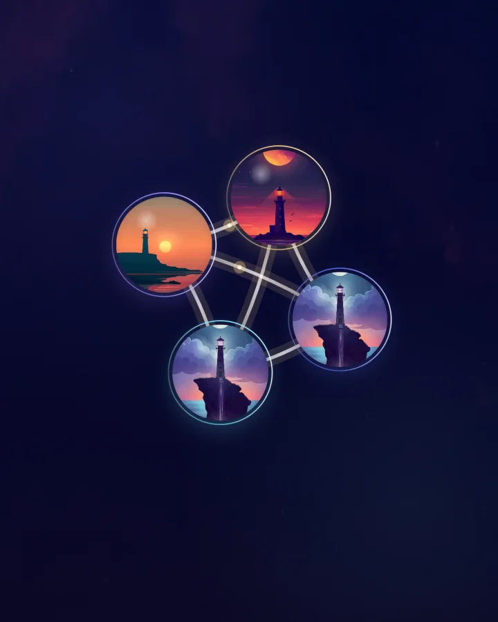
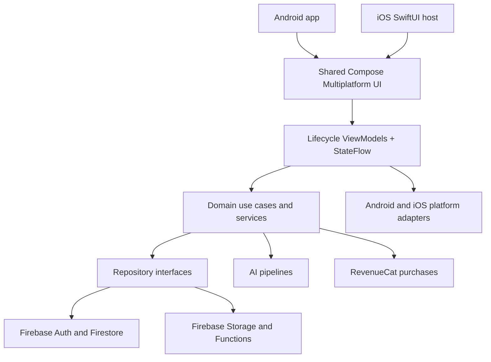

<p align="center">
  
</p>

<h1 align="center">DreamNorth</h1>

<p align="center">
  <strong>A production AI dream journal for capturing, understanding, and visualizing dreams on iOS and Android.</strong>
</p>

<p align="center">
  Built with Kotlin Multiplatform and Compose Multiplatform, backed by Firebase, and shipped as an independently designed and engineered mobile product.
</p>

<p align="center">
  <a href="https://apps.apple.com/us/app/dreamnorth-ai-dream-journal/id6754661165"><strong>App Store</strong></a>
  ·
  <a href="https://play.google.com/store/apps/details?id=org.ballistic.dreamjournalai"><strong>Google Play</strong></a>
  ·
  <a href="https://dream-north.com"><strong>Product website</strong></a>
  ·
  <a href="https://www.ericksorto.com/projects/dreamnorth"><strong>Portfolio case study</strong></a>
</p>

<p align="center">
  
  
  
  
</p>

## At a glance

| | |
|---|---|
| **Role** | Independent product engineer — product design, architecture, mobile implementation, cloud integration, monetization, and release ownership |
| **Platforms** | Android and iOS from one Kotlin Multiplatform codebase |
| **Product** | Private dream capture, AI interpretation, generated artwork, pattern discovery, and lucid-dream tools |
| **Core stack** | Kotlin, Compose Multiplatform, Coroutines/Flow, Koin, Firebase, Ktor, RevenueCat |
| **Production** | Available on both stores with authentication, cloud sync, purchases, analytics, notifications, and crash reporting |

## Product experience

DreamNorth is designed around the fragile minutes after waking, when a dream is easiest to lose. The product moves from fast capture to deeper reflection without forcing users into a complicated workflow.

- **Capture quickly** — rich-text journaling, search, voice recording, cloud transcription, sketches, sleep details, mood, vividness, lucidity, and custom backgrounds.
- **Understand meaning** — AI-assisted interpretations, mood analysis, stories, advice, dream-specific questions, and multi-dream analysis.
- **Visualize dreams** — generate artwork from an entry and use Dream World Painter to explore a dream as a visual scene.
- **Discover patterns** — statistics, streaks, dream types, recurring symbols, Emotional Radar, favorites, nightmares, and recurring-dream views.
- **Build better recall** — configurable journal reminders, reality checks, daily lessons, and generated-art notifications.
- **Take your journal with you** — account-scoped cloud history, media storage, cross-platform access, and PDF export.

## Current product screenshots

<table>
  <tr>
    <td align="center" width="25%"></td>
    <td align="center" width="25%"></td>
    <td align="center" width="25%"></td>
    <td align="center" width="25%"></td>
  </tr>
  <tr>
    <td align="center"><strong>Capture</strong><br />Record the details that make each dream useful later.</td>
    <td align="center"><strong>Understand</strong><br />Turn an entry into structured themes and reflection.</td>
    <td align="center"><strong>Visualize</strong><br />Generate and revisit the world behind a dream.</td>
    <td align="center"><strong>Discover</strong><br />Follow consistency, categories, and long-term patterns.</td>
  </tr>
</table>

## Dream Graph spotlight

<table>
  <tr>
    <td width="34%" align="center">
      
      <br />
      <sub>Actual Android 1.3.4 UI · synthetic sample dreams</sub>
    </td>
    <td width="66%">
      <strong>Dream Graph</strong>, presented in the app as <strong>Dream Map</strong>, turns journal history into an interactive constellation of related dreams. Each dream becomes a node, while connections appear only when deterministic scoring finds strong evidence such as shared symbols, corroborated themes, or matching Emotional Radar profiles.
      <br /><br />
      The graph is computed on-device rather than generated by an AI model. Connection thresholds and a five-edge-per-node cap keep larger journals readable, while a custom collision-aware layout supports pinch zoom, pan, node dragging, selection, connection explanations, and opening the original entry.
    </td>
  </tr>
</table>

Engineering work behind Dream Graph includes semantic normalization, dictionary-backed symbol extraction, deterministic scoring, balanced edge selection, responsive force/collision layout, reactive graph rebuilding, and explicit loading, empty, error, retry, and reset states. This feature is part of the current product branch and is being prepared for the next default-branch release.

## Architecture

DreamNorth shares its Compose UI, presentation logic, domain rules, repositories, and Firebase integrations between Android and iOS. Platform source sets stay focused on capabilities that genuinely differ: audio, permissions, notifications, secure storage, exports, store behavior, and native application setup.



### Architectural decisions

- **Shared product code, narrow platform seams.** Compose Multiplatform carries the product experience across both platforms; `expect`/`actual` and Koin platform modules isolate native integrations.
- **Feature-oriented MVVM.** Screens and ViewModels are organized by product capability, with `StateFlow` exposing observable UI state.
- **Domain and repository boundaries.** Use cases depend on repository contracts rather than Firebase implementations, keeping state orchestration testable and easier to evolve.
- **Reactive, account-scoped data.** Firestore snapshots stream the signed-in user's journal through `Flow`; generated images and recordings use stable Firebase Storage paths.
- **Hybrid AI pipeline.** OpenAI-powered experiences and Firebase Functions support text, image, and longer-running generation workflows; Gemini is used server-side for transcription and structured categorization.
- **Cross-platform commerce.** RevenueCat KMP centralizes offerings, subscriptions, entitlement state, restoration, and account synchronization.
- **Privacy-aware storage.** Selected dream text fields are encrypted client-side before Firestore writes, while authentication and media remain account-scoped.

## Technology

| Area | Implementation |
|---|---|
| **UI** | Compose Multiplatform, Material 3, Navigation Compose, Coil 3 |
| **Architecture** | Feature-oriented MVVM, repository pattern, domain use cases, Koin dependency injection |
| **Concurrency** | Kotlin Coroutines, Flow, StateFlow |
| **Cloud** | Firebase Authentication, Firestore, Storage, Functions, Analytics, Crashlytics, Cloud Messaging |
| **Networking** | Ktor with OkHttp on Android and Darwin on iOS |
| **AI** | OpenAI-powered generation plus Gemini-backed server workflows |
| **Purchases** | RevenueCat KMP |
| **Local settings** | DataStore / Multiplatform Settings |
| **Quality** | Shared Kotlin tests, Kermit logging, Firebase Crashlytics |

## Engineering highlights

- Built one production mobile experience for Android and iOS without duplicating the product layer.
- Modeled journal data as reactive account-scoped streams and handled authentication changes without leaking one user's state into another session.
- Coordinated dream text, audio recordings, generated images, and pending background generation jobs across cloud storage and UI state.
- Designed failure, loading, retry, and completion states for nondeterministic AI operations.
- Implemented Dream Graph as local deterministic analysis so relationship discovery remains fast, explainable, and testable.
- Integrated store-specific purchases, restoration, reminders, push notifications, permissions, audio, and exports behind platform boundaries.

## Testing

Shared tests cover domain behavior and cross-platform presentation logic, including dictionary loading, personalization context, onboarding, premium configuration, navigation selection, and Dream Graph semantics/layout in the current product branch.

The focused Dream Graph suite currently contains 25 passing tests across:

- semantic node and edge construction;
- evidence thresholds and connection caps;
- symbol extraction and normalization;
- deterministic force/collision layout behavior.

```bash
./gradlew :composeApp:shared:testDebugUnitTest --tests '*DreamMap*'
```

## Repository map

```text
composeApp/shared/
├── src/commonMain/       Shared Compose UI, ViewModels, domain, data, DI
├── src/androidMain/      Android application and platform integrations
├── src/iosMain/          iOS platform integrations and Compose controller
└── src/commonTest/       Shared domain and presentation tests

iosApp/                   SwiftUI host and Apple configuration
functions/                Firebase Functions and server-side AI workflows
docs/readme/              Optimized README media
```

## Running locally

### Prerequisites

- JDK 17
- A current Android Studio release compatible with the checked-in Gradle and Android Gradle Plugin versions
- Android SDK configured through `local.properties`
- Xcode and CocoaPods for iOS development
- Your own Firebase project configuration and required local secrets

### Android

```bash
./gradlew :composeApp:shared:assembleDebug
```

### iOS

Open `iosApp/iosApp.xcworkspace` in Xcode after installing CocoaPods dependencies, then run the `iosApp` scheme on a simulator or device.

A fresh local setup must provide or replace its own Firebase configuration, signing material, and service credentials. Keep private secrets out of version control.

## Privacy and support

- [Privacy policy](https://dream-north.com/privacy)
- [Terms of service](https://dream-north.com/terms)
- [Issue tracker](https://github.com/ErickSorto/Dream-Journal-AI/issues)

AI-generated interpretations are reflective tools, not medical or psychological advice.

## License and credits

Released under the repository's [MIT License](LICENSE).

Special thanks to [Amineib](https://github.com/Amineib) for early support.
